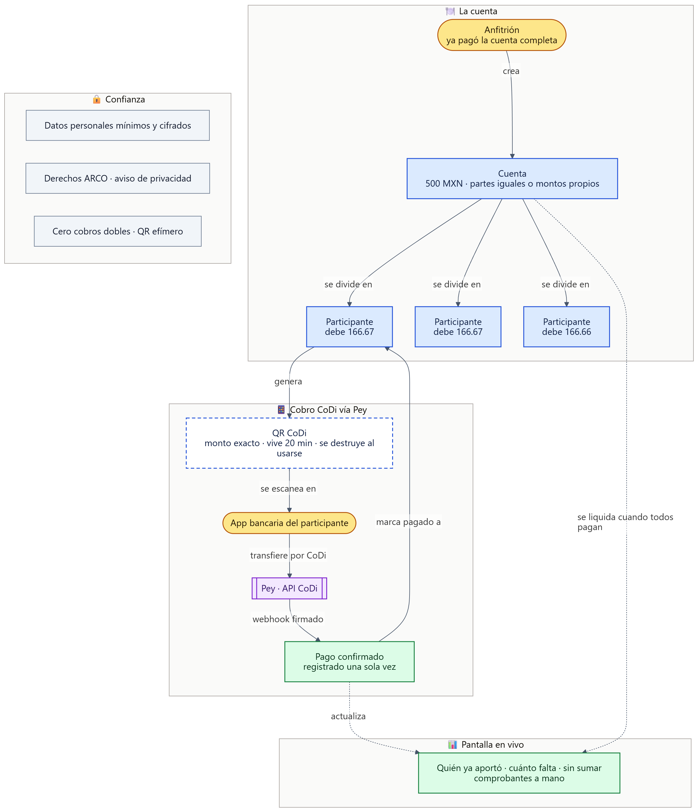

# CocinaPatito · SplitBill — la cuenta se divide sola y cada quien paga con CoDi

> **Hackathon Cursor México 2026 · reto Pey**
> Divide un gasto, genera un cobro CoDi por persona y muestra en una sola pantalla quién ya aportó y cuánto falta. Sin efectivo, sin comisiones de tarjeta, sin sumar comprobantes a mano.

---

## El problema

Salir en grupo termina igual casi siempre: una persona paga la cuenta completa y después persigue a los demás. Unos pagan en efectivo, otros "luego te transfiero", alguien manda una captura borrosa y nadie sabe cuánto falta. Con la ley de digitalización que entra en vigor el **14 de diciembre de 2026**, los negocios y las personas necesitan una forma de cobrar en digital que sea tan fácil como el efectivo y que no cueste comisión.

## La idea

SplitBill convierte una cuenta compartida en **un cobro CoDi por participante**:

1. **Quien ya pagó** crea la cuenta en la app, pone el total y a los participantes.
2. **La cuenta se divide**: en partes iguales (el sistema cuadra los centavos solo) o con el monto que cada quien decida.
3. **Cada participante recibe su propio QR CoDi** con su monto exacto. Lo escanea con la app de su banco y listo.
4. **La pantalla se actualiza en vivo**: quién ya aportó, cuánto falta. Cuando paga el último, la cuenta se liquida sola.

El dinero llega directo a la cuenta bancaria de quien pagó. Nadie intermedia, nadie se queda con comisión.

## Cómo usamos la API de Pey

Pey es la pieza que nos conecta con CoDi y Banxico sin que tengamos que ser un banco. Usamos exactamente dos capacidades de su API, y las usamos a fondo:

### 1. Un QR CoDi por cobro

Por cada participante pedimos a Pey un QR con tres datos: **el monto exacto que le toca**, un concepto legible ("Tacos del viernes") y **la cuenta bancaria del anfitrión** como destino. Pey genera el QR ante Banxico y nos devuelve el código para pintarlo en pantalla.

Dos decisiones que hacen la diferencia:

- **El QR vive 20 minutos.** Se lo pedimos así a Pey y lo respetamos de nuestro lado: pasado ese tiempo se destruye y se ofrece uno nuevo. Nunca circula un QR viejo.
- **El QR se destruye al usarse.** En cuanto Pey confirma el pago, el código desaparece del servidor y de la app. El mismo cobro no puede pagarse dos veces.

### 2. Pey nos avisa cuando el dinero llegó

No le preguntamos a nadie "¿ya pagaste?". Cuando el participante paga desde su banco, **Pey nos manda un aviso automático (webhook) firmado criptográficamente**. Nosotros:

- comprobamos la firma para saber que viene de Pey y no de alguien imitándolo;
- confirmamos el pago directamente con Pey antes de darlo por bueno;
- lo registramos **una sola vez**, aunque el aviso llegue repetido;
- marcamos al participante como pagado y actualizamos la pantalla de todos al instante.

Si llega un pago que no cuadra (monto distinto, QR ya usado), no se pierde: queda marcado para revisarlo, y nunca se cobra de más.

### Qué aporta esto al ecosistema Pey

- **Un caso de uso cotidiano** que pone CoDi en manos de gente que hoy divide cuentas con efectivo o transferencias manuales.
- **Muchos cobros pequeños y seguros** en vez de uno grande: justo el patrón donde CoDi gana por no tener comisión.
- **Integración limpia**: usamos la API pública tal como está documentada, sin trucos, y el diseño está listo para extenderse a otros flujos de Pey (notificaciones push CoDi, links de pago) sin rehacer nada.

## Confianza desde el diseño

- **Sin cobros dobles.** Un solo QR activo por persona, cada pago de Pey registrado una única vez, y verificación con Pey antes de marcar pagado.
- **Datos personales mínimos y cifrados.** Guardamos lo indispensable; correo y teléfono viajan y se almacenan cifrados. La CLABE completa nunca toca nuestra base: la custodia Pey.
- **Ley de protección de datos (LFPDPPP).** Aviso de privacidad versionado y derechos ARCO (acceso, rectificación, cancelación, oposición) contemplados desde el modelo de datos, no como parche.
- **Seguridad de principio a fin.** Comunicación cifrada, firmas verificadas en cada aviso de Pey, sin secretos en el código, y un diseño revisado contra el OWASP Top 10 2025.
- **Construido con pruebas primero.** La regla de reparto, la cuenta y el ciclo de vida del QR tienen más de mil casos de prueba automáticos antes de escribir una sola pantalla.

## Qué verán en la demo

1. Se crea una cuenta de $500 entre tres personas.
2. Aparecen tres QR CoDi, cada uno con su monto exacto y su cuenta regresiva.
3. Un participante paga desde su app bancaria.
4. En la pantalla del grupo, ese participante pasa a "pagado" y el faltante baja, sin tocar nada.
5. Cuando pagan los tres, la cuenta se marca liquidada.

> Pey todavía no tiene ambiente de pruebas, así que la demo usa pagos reales de $0.01 MXN.

## Para el equipo técnico

La arquitectura, el modelo de datos y las notas de la API de Pey están en [docs/](docs/00-developer-guide.md).
Stack: C# / .NET 10, PostgreSQL 18, Dapper, JWT, arquitectura hexagonal y orientada a eventos, Docker.
