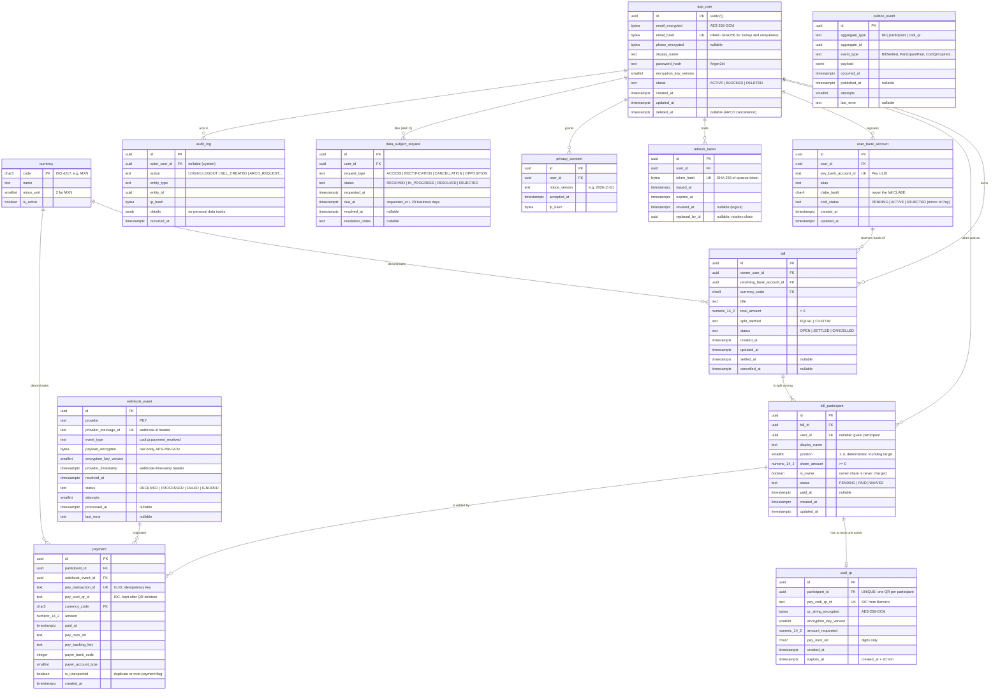

# Modelo de datos — "Cuenta entre varias personas" (CoDi vía Pey)

> Identificadores en inglés (tablas, columnas, enums, eventos). Prosa en español para el equipo.
> Motor: **PostgreSQL 18.7** (última versión estable; 19 está en RC y no se recomienda para producción).
> Sin SQL dinámico: todas las consultas son sentencias estáticas parametrizadas vía Dapper.

---

## 1. Decisiones de diseño que condicionan el modelo

| Tema | Decisión | Motivo |
|---|---|---|
| Dinero | `numeric(14,2)` + columna `currency_code` (FK a `currency`) | 2 decimales hoy; `currency.minor_unit` deja abierta la puerta a otras divisas. Nunca `float`/`double`. |
| Divisa | Tabla `currency` con una sola fila activa (`MXN`) | Futura extensión sin tocar el esquema. Tipo de cambio queda fuera de alcance (se agregaría `exchange_rate` después). |
| Claves primarias | `uuid` generado con `uuidv7()` (nativo en PG 18) | Ordenable por tiempo (índices B-tree eficientes), no enumerable desde el exterior (evita IDOR, OWASP A01). |
| Timestamps | `timestamptz`, sufijo `_at`, siempre UTC | Fechas de Pey vienen en epoch segundos; se convierten al entrar. |
| Estados | `text` + `CHECK (status IN (...))` | Más simple de migrar que `ENUM` nativo; igual de seguro. |
| Nombres | `snake_case`, tablas en singular, FK `<entidad>_id`, booleanos `is_*` | Convención uniforme y legible desde Dapper. |
| Borrado | Lógico (`deleted_at`) en `app_user`; físico en `codi_qr` | ARCO (cancelación) vs. requisito de desechar QRs. |
| Datos sensibles | Cifrado a nivel aplicación AES-256-GCM (`bytea` + `key_version`) | Cifrado en reposo independiente del disco; permite rotación de llave. |
| Derivados | No se almacenan totales calculables (cuánto falta, cuánto se ha pagado) | 3FN: se obtienen con `SUM()` sobre `bill_participant`/`payment`. |

---

## 2. Diagrama Entidad–Relación

> Nota Mermaid: `char3`, `char7`, `numeric_14_2` representan `char(3)`, `char(7)` y `numeric(14,2)` (Mermaid no acepta paréntesis en los tipos).

---

## 3. Catálogo de tablas y recomendaciones de columnas

### 3.1 `currency`
Catálogo de divisas. Hoy solo `MXN` activa. `minor_unit` indica decimales (2). Cuando se agregue otra divisa solo se inserta una fila; si alguna divisa requiriera 3 decimales se ampliaría `numeric(14,2)` → `numeric(14,3)` con un único `ALTER`.

### 3.2 `app_user`
Usuario de la plataforma (dueño de cuentas o participante registrado).

| Columna | Tipo | Nota |
|---|---|---|
| `id` | `uuid` DEFAULT `uuidv7()` | |
| `email_encrypted` | `bytea` NOT NULL | Cifrado AES-256-GCM, nonce incluido en el blob. |
| `email_hash` | `bytea` NOT NULL UNIQUE | HMAC-SHA256(email normalizado, llave de índice). Permite `WHERE email_hash = @hash` sin descifrar. |
| `phone_encrypted` | `bytea` NULL | Solo si el producto lo necesita (minimización). |
| `display_name` | `text` NOT NULL | Lo único legible en claro; es lo que ven los demás participantes. |
| `password_hash` | `text` NOT NULL | Argon2id (`Konscious.Security.Cryptography` o `Isopoh.Cryptography.Argon2`). |
| `encryption_key_version` | `smallint` NOT NULL | Para rotación de llaves sin re-cifrar todo de golpe. |
| `status` | `text` CHECK | `ACTIVE`, `BLOCKED`, `DELETED`. |
| `created_at`, `updated_at`, `deleted_at` | `timestamptz` | `deleted_at` = ejecución del derecho ARCO de cancelación. |

Índices: `UNIQUE (email_hash)`; parcial `(status) WHERE deleted_at IS NULL`.

### 3.3 `privacy_consent`
Evidencia de aceptación del aviso de privacidad (obligación LFPDPPP). Una fila por versión aceptada. Nunca se borra; al cancelar al usuario se conserva como prueba (se anonimiza `ip_hash`).

### 3.4 `refresh_token`
Soporte de login/logout sin estado global (prohibido Singleton aquí → servicios *scoped* que leen/escriben esta tabla).

| Columna | Nota |
|---|---|
| `token_hash` UNIQUE | Solo se guarda el hash SHA-256 del token opaco; el token real viaja una vez al cliente. |
| `expires_at` | 7–30 días. |
| `revoked_at` | Logout = `UPDATE … SET revoked_at = now()`. Logout global = revocar todos los del `user_id`. |
| `replaced_by_id` | Rotación: al refrescar se emite uno nuevo y se enlaza. Reuso de uno ya rotado ⇒ se revoca toda la cadena (detección de robo). |

Índices: `(user_id) WHERE revoked_at IS NULL`.

### 3.5 `user_bank_account`
Cuenta bancaria del dueño de la cuenta, **registrada en Pey** (`POST /bank-account`). Nosotros guardamos el `pey_bank_account_id` y los últimos 4 dígitos de la CLABE; **la CLABE completa nunca se persiste en nuestra BD** (minimización de datos y menor superficie ante fuga). `codi_status` se actualiza con el webhook `bank-account.updated`.

### 3.6 `bill`
La "cuenta" a dividir.

| Columna | Nota |
|---|---|
| `owner_user_id` | Quien pagó el total y recibirá los CoDi. |
| `receiving_bank_account_id` | FK a `user_bank_account`; se envía como `bankAccountId` a Pey en cada QR. |
| `currency_code` | FK `currency`. Una cuenta tiene una sola divisa. |
| `total_amount` | `numeric(14,2)` CHECK `> 0`. |
| `split_method` | `EQUAL` (entre n) o `CUSTOM` (cada quien su importe). Solo uno por cuenta. |
| `status` | `OPEN`, `SETTLED`, `CANCELLED`. El "parcialmente pagado" **no se guarda**: se deriva (ver §5). |

Índices: `(owner_user_id, status)`, `(created_at DESC)`.

### 3.7 `bill_participant`
Cada persona entre las que se divide la cuenta y **su cobro**. Decidimos no crear una tabla `charge` aparte: el cobro es 1:1 con el participante, así que separarlos sería sobreingeniería. Si en el futuro se requieren pagos parciales o varios cobros por persona, se extrae `charge` con una migración acotada.

| Columna | Nota |
|---|---|
| `user_id` | NULL para invitados sin cuenta (se identifican por `display_name`; el QR se comparte por link). |
| `position` | 1..n. Define **determinísticamente** quién absorbe el ajuste de centavos (§4). |
| `share_amount` | `numeric(14,2)` CHECK `>= 0`. |
| `is_owner` | El dueño puede estar en el reparto, pero su parte no se cobra por CoDi (ya pagó). Se marca `WAIVED`. |
| `status` | `PENDING`, `PAID`, `WAIVED`. |

Restricciones: `UNIQUE (bill_id, position)`; `UNIQUE (bill_id, user_id) WHERE user_id IS NOT NULL`; CHECK `(is_owner = false OR status = 'WAIVED')`. Invariante de negocio: `SUM(share_amount) = bill.total_amount`, validada en la transacción de creación/edición.

### 3.8 `codi_qr`
QR vivo generado en Pey. **Es efímero por diseño**:

- Se crea en la misma transacción en que se registra la respuesta de Pey (`id` → `pey_codi_qr_id`, `qrString` → cifrado).
- `expires_at = created_at + interval '20 minutes'`; a Pey se envía `expiration = 1200`.
- Se **borra físicamente** (a) al recibir el pago (misma transacción que inserta `payment`), (b) cuando un job detecta `expires_at < now()`, (c) al cancelar la cuenta.
- `UNIQUE (participant_id)` garantiza **un solo QR activo por cobro** → base de la idempotencia contra cobros dobles. Antes de crear uno nuevo, la transacción elimina el expirado si aún existe.
- `qr_string_encrypted` porque el `qrString` contiene datos de la cuenta receptora; lo tratamos como sensible.

Índices: `(expires_at)` para el job de limpieza; `UNIQUE (pey_codi_qr_id)` para resolver el webhook.

### 3.9 `payment`
Hecho inmutable: un pago confirmado por Pey. Nunca se actualiza ni borra (solo se anonimiza el vínculo si el usuario ejerce cancelación).

| Columna | Nota |
|---|---|
| `pey_transaction_id` UNIQUE | **Llave de idempotencia**: el mismo webhook reenviado por Pey no genera dos pagos. |
| `pey_codi_qr_id` | Copia del IDC; sobrevive al borrado de `codi_qr` para poder correlacionar reenvíos tardíos. |
| `amount`, `currency_code` | Lo que Pey reporta (puede diferir de `share_amount` ⇒ `is_unexpected`). |
| `payer_bank_code`, `payer_account_type` | Códigos Banxico, no identifican a la persona. |
| `is_unexpected` | `true` si llega para un participante ya `PAID`, con monto distinto, o para un QR desconocido. Se emite evento `UnexpectedPaymentReceived` para conciliación manual (reembolso). |

**No se guarda `metadata.clabe` del pagador** (dato personal financiero de un tercero que no es usuario nuestro; no hay finalidad que lo justifique). Si el negocio lo exigiera, iría como `payer_clabe_encrypted` con retención corta.

Índices: `(participant_id)`, `(pey_codi_qr_id)`, `(paid_at DESC)`.

### 3.10 `webhook_event` (inbox)
Bandeja de entrada de webhooks. El endpoint HTTP solo **verifica firma, inserta aquí y responde 200**; el procesamiento es asíncrono.

| Columna | Nota |
|---|---|
| `provider_message_id` UNIQUE | Header `webhook-id` (Standard Webhooks). `INSERT … ON CONFLICT DO NOTHING` = deduplicación. |
| `provider_timestamp` | Header `webhook-timestamp`; se rechaza si difiere > 5 min del reloj (anti-replay). |
| `payload_encrypted` | Cuerpo crudo cifrado (contiene CLABE del pagador). Retención 90 días y purga. |
| `status`, `attempts`, `last_error` | Reintentos con back-off desde el worker. `IGNORED` = tipo de evento que no nos interesa. |

### 3.11 `outbox_event`
Patrón *transactional outbox*: los eventos de dominio se insertan en la **misma transacción** que el cambio de estado y un relay los publica después. Garantiza que `ParticipantPaid` solo se publique si el `payment` realmente quedó en BD. Es lo que hace honesta la arquitectura *event driven* sin necesitar 2PC.

### 3.12 `audit_log`
Trazabilidad para OWASP A09 (logging) y para evidenciar cumplimiento. `details` en `jsonb` **sin datos personales** (solo IDs). `ip_hash` en lugar de IP en claro. Retención 12 meses.

### 3.13 `data_subject_request`
Registro de solicitudes ARCO (Acceso, Rectificación, Cancelación, Oposición). `due_at` = 20 días hábiles (plazo legal). Ejecución:
- **Acceso**: exportación JSON vía serializer dedicado.
- **Rectificación**: `UPDATE app_user` de `display_name` / `email_*` / `phone_*`.
- **Cancelación**: `deleted_at`, `status = DELETED`, se sobrescriben `email_encrypted`/`phone_encrypted` con NULL y `email_hash` con un valor aleatorio; `bill_participant.user_id` se conserva (clave) pero el usuario ya no es identificable. Los `payment` se mantienen por obligación de conservación de operaciones financieras (excepción prevista en la ley).
- **Oposición**: `status = BLOCKED` + bandera en `privacy_consent`.

---

## 4. Algoritmo de reparto (dominio, `SplitCalculator`)

Entrada: `total` (2 decimales), `n` participantes, método.

**`CUSTOM`**: el cliente envía cada `share_amount`. Validación: todos `>= 0`, exactamente 2 decimales, `SUM = total`. Si no cuadra se rechaza con `400` (no se "arregla" solo).

**`EQUAL`**:
1. `raw = total / n` con precisión completa (`decimal` en C#, nunca `double`).
2. `base = round(raw, 2, MidpointRounding.AwayFromZero)` — implementa exactamente la regla del equipo: 3er decimal `< 5` baja (`33.333 → 33.33`), `>= 5` sube (`14.2857 → 14.29`).
3. `delta = total − base × n` (puede ser positivo o negativo, múltiplo de 0.01).
4. El participante con `position = 1` absorbe `delta` completo: `share₁ = base + delta`. Los demás reciben `base`.
5. Invariante verificada antes de persistir: `Σ share = total` y todas las partes `>= 0`.

Ejemplos del equipo:
- `100 / 3`: base `33.33`, Σ `99.99`, delta `+0.01` → `[33.34, 33.33, 33.33]`.
- `100 / 7`: base `14.29`, Σ `100.03`, delta `−0.03` → `[14.26, 14.29, 14.29, 14.29, 14.29, 14.29, 14.29]`.

Nota: con `n` grande el `delta` puede crecer (máx. `±0.005·n`); si el equipo prefiere repartir el ajuste de a un centavo entre los primeros `|delta|/0.01` participantes, es un cambio local en el paso 4 y quedaría cubierto por los mismos tests. Lo dejamos en una sola persona porque así lo definió el equipo.

---

## 5. Consultas de pantalla "quién aportó y cuánto falta"
Todo derivado, nada almacenado:

- Pagado: `SUM(payment.amount)` de pagos no `is_unexpected` por `bill_id` (vía `bill_participant`).
- Faltante: `bill.total_amount − Σ share_amount WHERE status IN ('PAID','WAIVED')`.
- Por participante: `status`, `share_amount`, `paid_at`, y si existe `codi_qr` vigente (`expires_at > now()`), el tiempo restante.

Una sola sentencia estática con `LEFT JOIN` + `GROUP BY`; devuelve un DTO (`BillSummaryResponse`) que **no** incluye `qr_string` ni datos del pagador.

---

## 6. Transacciones (dónde sí y dónde no)

| Caso de uso | Transacción | Rollback si… |
|---|---|---|
| Crear cuenta | `bill` + `bill_participant[]` + `outbox_event(BillCreated)` | Σ shares ≠ total, participante duplicado. |
| Generar QR | 1) `DELETE codi_qr` expirado del participante; 2) llamada HTTP a Pey **fuera** de la transacción; 3) `INSERT codi_qr` + `outbox_event(CodiQrIssued)` | Fallo de Pey ⇒ nada se inserta. Timeout ambiguo ⇒ se marca intento y **no se reintenta automáticamente** (ver arquitectura, idempotencia). |
| Recibir webhook | `INSERT webhook_event ON CONFLICT DO NOTHING`, commit, responder 200 | Firma inválida ⇒ 400 sin insertar. |
| Procesar pago | `INSERT payment` + `UPDATE bill_participant SET status='PAID'` + `DELETE codi_qr` + (si todos pagados) `UPDATE bill SET status='SETTLED'` + `outbox_event(ParticipantPaid / BillSettled)` + `UPDATE webhook_event SET status='PROCESSED'` | Cualquier error ⇒ rollback completo, `attempts+1`, reintento con back-off. `pey_transaction_id` duplicado ⇒ se marca `PROCESSED` sin efecto (idempotente). |
| Expirar QR | `DELETE codi_qr WHERE expires_at < now()` + `outbox_event(CodiQrExpired)` por fila | Lote pequeño (≤100) por iteración. |
| Logout | `UPDATE refresh_token SET revoked_at` | — |

Nivel de aislamiento: `READ COMMITTED` (default) basta; las unicidades (`pey_transaction_id`, `participant_id` en `codi_qr`) son las que protegen contra carreras, no bloqueos pesimistas.

---

## 7. Cifrado en reposo

- **Volumen/disco**: cifrado del proveedor (EBS / Azure Disk / LUKS) + backups cifrados. Obligatorio pero insuficiente por sí solo.
- **Columna**: AES-256-GCM en .NET (`System.Security.Cryptography.AesGcm`), nonce de 12 bytes aleatorio por valor, tag de 16 bytes, formato del blob `[version(1)][nonce(12)][tag(16)][ciphertext]`. Llave maestra en un gestor de secretos (Azure Key Vault / AWS KMS / HashiCorp Vault / Docker secret en dev), **nunca en appsettings ni en el repo**. `encryption_key_version` permite rotación perezosa.
- **Búsqueda sobre cifrados**: solo por hash HMAC (`email_hash`); nunca se descifra en SQL. Por eso **no** usamos `pgcrypto`: obligaría a pasar la llave en el texto de la consulta (y a los logs de PostgreSQL).
- **TLS obligatorio** entre API y PostgreSQL (`SSL Mode=VerifyFull` en la cadena Npgsql).
- Campos cifrados: `email_encrypted`, `phone_encrypted`, `qr_string_encrypted`, `webhook_event.payload_encrypted`. Hash: `email_hash`, `token_hash`, `ip_hash`, `password_hash` (Argon2id, no reversible).

---

## 8. Retención y limpieza (jobs del worker)

| Dato | Regla |
|---|---|
| `codi_qr` | Borrado al pagar o a los 20 min. Job cada 60 s. |
| `webhook_event.payload_encrypted` | Se pone a NULL a los 90 días; la fila (metadatos) se conserva 12 meses. |
| `refresh_token` | Se borran los expirados/revocados > 30 días. |
| `audit_log` | 12 meses. |
| `app_user` cancelado | Anonimizado inmediato; fila conservada como "tombstone" para integridad referencial. |

---

## 9. Verificación de 3FN

- Cada tabla tiene PK simple (`id`) y todos los atributos dependen solo de ella (1FN/2FN).
- Sin dependencias transitivas: `currency` no se repite en `bill_participant` ni `codi_qr` (se obtiene por `bill`); datos del banco receptor viven en `user_bank_account`, no en `bill`; códigos Banxico del pagador se guardan en `payment` porque pertenecen a ese hecho, no al participante.
- Única desnormalización consciente: `payment.pey_codi_qr_id` (copia del IDC), necesaria porque la fila origen (`codi_qr`) se destruye por requisito funcional. Está documentada y es inmutable.
- Los agregados (pagado / faltante / estado parcial) nunca se materializan.
