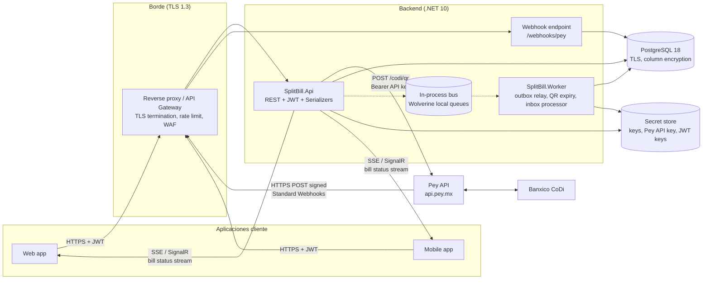
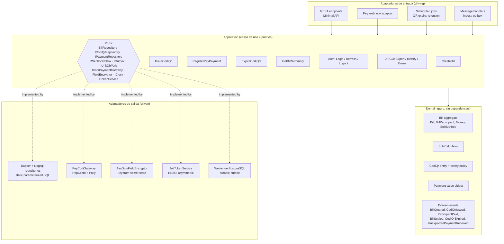
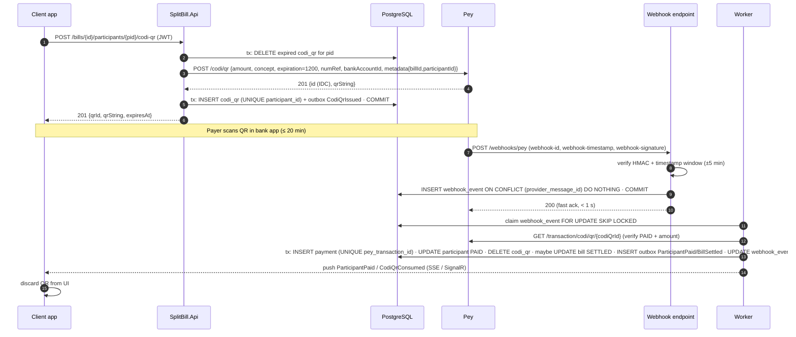

# Arquitectura del backend — "Cuenta entre varias personas" (CoDi vía Pey)

> Backend puro (sin UI) consumido por varias aplicaciones. C# / .NET 10 (LTS), Dapper + Npgsql, PostgreSQL 18.7, JWT, arquitectura hexagonal + event driven.
> Este documento es análisis: no hay código aún. Los nombres de clases/eventos son la propuesta para cuando el equipo dé luz verde.

---

## 1. Vista de contexto

**Aclaración sobre "conexión perpetua" del webhook**: un webhook **no** es una conexión persistente. Pey abre una petición HTTPS POST nueva por cada evento y la cierra con nuestra respuesta. La superficie expuesta es un único endpoint público (`POST /webhooks/pey`) que debe tratarse como entrada hostil: cualquiera en Internet puede enviarle bytes. La defensa no es la red, es la **firma criptográfica** + **ventana temporal** + **deduplicación** + **no confiar en el payload para decidir dinero** (ver §6).

---

## 2. Arquitectura hexagonal (puertos y adaptadores)

### 2.1 Capas y reglas de dependencia

| Capa / proyecto | Contiene | Depende de |
|---|---|---|
| `SplitBill.Domain` | Entidades, value objects (`Money`, `CurrencyCode`), `SplitCalculator`, políticas (`CodiQrExpiryPolicy`), eventos de dominio, excepciones de dominio. **Cero NuGets.** | nada |
| `SplitBill.Application` | Casos de uso (un *handler* por comando/consulta), **puertos** (interfaces), DTOs de entrada, validadores, mapeo a eventos de integración. | Domain |
| `SplitBill.Infrastructure` | Adaptadores: repositorios Dapper, `PeyCodiGateway`, cifrado, JWT, Standard Webhooks verifier, outbox Wolverine, `SystemClock`. | Application, Domain |
| `SplitBill.Api` | Minimal API endpoints, autenticación JWT, **serializers** (response models + mappers), middleware de errores, health checks, OpenAPI. Composición DI. | Application, Infrastructure |
| `SplitBill.Worker` | Hosted services: relay del outbox, procesador del inbox, job de expiración de QR, jobs de retención. Composición DI propia (mismo Infrastructure). | Application, Infrastructure |
| `tests/SplitBill.Domain.Tests` | xUnit + FluentAssertions. 100 % puro, sin BD. TDD empieza aquí. | Domain |
| `tests/SplitBill.Application.Tests` | Casos de uso con puertos *fakes* (NSubstitute). | Application |
| `tests/SplitBill.Infrastructure.Tests` | Testcontainers (PostgreSQL 18) para repositorios y migraciones; WireMock para Pey; vectores de Standard Webhooks. | Infrastructure |
| `tests/SplitBill.Api.Tests` | `WebApplicationFactory`: contratos de endpoints, serializers (qué campos **no** salen), auth. | Api |

Regla única: las flechas de dependencia apuntan hacia adentro. `Domain` nunca sabe que existen Dapper, Pey o HTTP.

### 2.2 Puertos (interfaces) propuestos

| Puerto | Responsabilidad | Adaptador |
|---|---|---|
| `IBillRepository`, `IBillParticipantRepository`, `ICodiQrRepository`, `IPaymentRepository`, `IUserRepository`, `IRefreshTokenRepository` | Persistencia por agregado. Solo SQL estático. | Dapper/Npgsql |
| `IUnitOfWork` | Abre `NpgsqlTransaction`, expone `CommitAsync`/`RollbackAsync`; **scoped** por request/mensaje. | Npgsql |
| `IWebhookInbox` / `IOutbox` | Insertar evento recibido / evento a publicar dentro de la transacción actual. | Dapper + Wolverine |
| `ICodiPaymentGateway` | `CreateQrAsync(CreateCodiQrRequest)`, `GetQrTransactionsAsync(idc)`. Único lugar que conoce Pey. | `PeyCodiGateway` |
| `IWebhookSignatureVerifier` | Verifica `webhook-id`, `webhook-timestamp`, `webhook-signature`. | `StandardWebhooks` NuGet |
| `IFieldEncryptor` | `Encrypt(plaintext) → EncryptedValue(version, bytes)`, `Decrypt`. `ComputeLookupHash(email)`. | AES-GCM + HMAC |
| `IPasswordHasher` | Argon2id. | Konscious / Isopoh |
| `ITokenService` | Emite/valida JWT de acceso; emite refresh opaco. | `System.IdentityModel.Tokens.Jwt` |
| `IClock` | `UtcNow`. Imprescindible para testear expiraciones de 20 min. | `SystemClock` |
| `IBillEventsPublisher` | Notificación en tiempo real a clientes (SSE/SignalR). | SignalR hub o SSE writer |

---

## 3. Inyección de dependencias y ciclos de vida

| Servicio | Lifetime | Por qué |
|---|---|---|
| `NpgsqlDataSource` | Singleton | Es el *pool* de conexiones; es la excepción legítima y recomendada por Npgsql. No guarda estado de negocio. |
| `IUnitOfWork`, repositorios, `IWebhookInbox`, `IOutbox` | **Scoped** | Una transacción por request/mensaje. Prohibido Singleton: compartiría conexión/transacción entre requests. |
| Casos de uso (`CreateBillHandler`, …) | Scoped | Reciben UoW scoped. |
| `ITokenService`, `IRefreshTokenRepository`, `LoginHandler`, `LogoutHandler`, `RefreshSessionHandler` | **Scoped** (requisito explícito: nada de Singleton en login/logout) | El estado de sesión vive en `refresh_token` (BD), nunca en memoria del proceso. Esto además permite escalar a N réplicas. |
| `IFieldEncryptor`, `IPasswordHasher`, `IClock`, `IWebhookSignatureVerifier` | Singleton | Sin estado mutable; solo llaves inmutables cargadas al inicio desde el secret store. |
| `ICodiPaymentGateway` | Transient vía `IHttpClientFactory` (typed client) | Reutiliza handlers HTTP, respeta rotación DNS, aplica Polly. |
| `HybridCache` (si se usa para catálogo `currency`) | Singleton | Solo datos de referencia. |

Validación en arranque: `ValidateOnBuild = true` y `ValidateScopes = true` para que un Singleton que capture un Scoped **falle al iniciar**, no en producción.

---

## 4. Event driven: flujo de pago y garantías

### 4.1 Idempotencia (evitar cobros dobles): tres candados

1. **Un QR activo por participante**: `UNIQUE (participant_id)` en `codi_qr`. Dos clics simultáneos en "generar QR" → el segundo INSERT falla y el caso de uso devuelve el QR existente (lectura) en vez de crear otro. Pey no documenta `Idempotency-Key`, así que la idempotencia de salida la garantizamos nosotros con la BD.
2. **Un pago por transacción de Pey**: `UNIQUE (pey_transaction_id)` en `payment`. Reentregas del webhook (Pey reintenta si no respondemos 2xx) terminan en `ON CONFLICT` y se marcan `PROCESSED`.
3. **Dedupe de mensaje**: `UNIQUE (provider_message_id)` = header `webhook-id` en el inbox. Es la primera línea; la 2 es la red de seguridad si Pey emite el mismo pago con dos `webhook-id` distintos.

**Fallback ante ambigüedad** (timeout al llamar `POST /codi/qr`: no sabemos si Pey lo creó): no reintentar a ciegas. Se registra en `audit_log` y se responde `503` al cliente con `Retry-After`; al reintentar, el caso de uso vuelve a consultar `codi_qr` (si el primero sí quedó registrado lo devuelve). Si Pey creó un QR que nosotros no registramos, simplemente expirará en 20 min sin que nadie lo vea. Si alguien llegara a pagarlo, el webhook caerá en "QR desconocido" → `payment.is_unexpected = true` + evento `UnexpectedPaymentReceived` para conciliación/reembolso manual. **Nunca se cobra dos veces por un fallo nuestro**: el peor caso es un QR huérfano.

**Pago para participante ya `PAID`** (dos personas escanearon el mismo QR compartido): segundo pago → `is_unexpected = true`, participante sigue `PAID`, se notifica al dueño para reembolsar. Mitigación en frontend: ocultar el QR en cuanto llega `ParticipantPaid`.

### 4.2 Tecnología para mensajería y webhooks (recomendación)

| Necesidad | Recomendación | Alternativa | Por qué |
|---|---|---|---|
| Recibir webhooks de Pey | **ASP.NET Core Minimal API** + NuGet **`StandardWebhooks`** (implementación oficial C# de la spec que usa Pey) | Verificación manual HMAC-SHA256 | La spec ya resuelve firma, timestamp y rotación de secreto (acepta varias firmas en el header `webhook-signature`, separadas por espacio). No reinventar. |
| Bus de eventos / outbox / inbox | **Wolverine** (`WolverineFx` + `WolverineFx.Postgresql`) | MassTransit + RabbitMQ | Wolverine ofrece *durable outbox/inbox sobre PostgreSQL* y colas locales, se enlista en la misma `NpgsqlTransaction` que Dapper, y no exige un broker adicional en el hackathon. Si mañana se necesita RabbitMQ/Azure Service Bus, es cambiar el transporte, no los handlers. MassTransit es excelente, pero su outbox está acoplado a EF Core. |
| Reintentos/circuit breaker hacia Pey | **Polly v8** vía `Microsoft.Extensions.Http.Resilience` | — | Reintentos solo en `GET`; en `POST /codi/qr` reintentar únicamente ante fallo de conexión antes de enviar el cuerpo (nunca ante timeout de respuesta). |
| Push a clientes | **SignalR** (`BillHub`, grupo por `billId`) | SSE | SignalR ya es .NET, autentica con el mismo JWT y reconecta solo. Para apps móviles nativas SSE es más simple; decidir con frontend. |
| Jobs programados | `BackgroundService` con `PeriodicTimer` dentro de `SplitBill.Worker` | Quartz.NET / Hangfire | Dos jobs (expiración QR cada 60 s, retención diaria) no justifican un scheduler con BD propia. |

---

## 5. Autenticación y sesiones (JWT)

- **Access token JWT** firmado **ES256** (ECDSA P-256, asimétrico): la API valida con la clave pública, solo el emisor tiene la privada (en el secret store). Vida **15 min**. Claims mínimos: `sub` (user id), `jti`, `iat`, `exp`, `iss`, `aud`. **Nada de datos personales** en el token (es base64, no cifrado).
- **Refresh token** opaco de 256 bits, guardado como hash (`refresh_token.token_hash`), vida 14 días, **rotación en cada uso** y detección de reuso (revocación en cadena).
- **Logout** = revocar refresh token (o todos los del usuario). El access token expira solo en ≤15 min; si se requiere revocación inmediata, se consulta `jti` contra una lista de revocados en BD con TTL (sigue sin Singleton).
- Contraseñas: Argon2id (m=64 MiB, t=3, p=1), *pepper* desde el secret store opcional. Límite de intentos por `email_hash` + IP (rate limit) → OWASP A07.
- Autorización por recurso: cada caso de uso recibe `actorUserId` y el repositorio filtra (`WHERE bill.owner_user_id = @actor OR EXISTS participant`). Nunca confiar en que el `id` del path pertenece al usuario (IDOR, A01). Los IDs `uuidv7` no son adivinables, pero eso es defensa en profundidad, no autorización.
- Invitados sin cuenta: acceden a su QR mediante **link firmado** (token HMAC de corta vida con `participantId` + `exp`) — nunca por el `participantId` en claro.

---

## 6. Seguridad del endpoint de webhooks (Standard Webhooks + OWASP)

Pey firma con **Standard Webhooks**: headers `webhook-id`, `webhook-timestamp` (epoch s), `webhook-signature` (`v1,<base64(HMAC-SHA256(secret, "{id}.{timestamp}.{body}"))>`), secreto con prefijo `whsec_` en base64. Una API key = un webhook = un secreto; el secreto se rota desde el portal de Pey.

Checklist del adaptador `PeyWebhookEndpoint`:

1. **Solo HTTPS** (TLS 1.3 preferido, 1.2 mínimo, HSTS). HTTP → 301 nunca; simplemente no escuchar.
2. **Límite de tamaño** del cuerpo (p. ej. 64 KiB) y `Content-Type: application/json` obligatorio.
3. **Leer el cuerpo crudo como bytes** antes de deserializar; la firma se calcula sobre bytes exactos.
4. **Verificar firma** con `StandardWebhooks` y el secreto del secret store (soporta rotación: varias firmas separadas por espacio). Fallo → `400` genérico, sin detalles, y contador de métricas.
5. **Ventana temporal** `|now − webhook-timestamp| ≤ 5 min` (anti-replay).
6. **Dedupe** por `webhook-id` (`ON CONFLICT DO NOTHING`).
7. **Responder `200` en < 1 s** sin lógica de negocio; Pey registra los intentos en su portal (Desarrollador → Webhook Logs).
8. **No confiar en `amount` del payload para marcar pagado**: el worker **verifica contra Pey** (`GET /transaction/codi/qr/{idc}` → `status = PAID`, `amount`) antes de insertar `payment`. Así un payload forjado con firma válida (secreto filtrado) tampoco libera dinero inexistente.
9. **Rate limit** por IP en el reverse proxy y `RateLimiter` de ASP.NET (fixed window) en el endpoint.
10. El cuerpo se **cifra** antes de persistir (`payload_encrypted`); los logs de aplicación **jamás** imprimen el body (contiene CLABE del pagador).
11. Secret store: el `whsec_…` y la API key de Pey se cargan en arranque desde variables inyectadas por el orquestador / Key Vault; **no existen en `appsettings*.json`, Dockerfile ni repo** (`.env.example` con placeholders, `.env` en `.gitignore`).

### 6.1 Mapeo OWASP Top 10 – 2025

| Riesgo | Mitigación en este diseño |
|---|---|
| A01 Broken Access Control | Autorización por recurso en cada caso de uso; IDs uuidv7; links firmados para invitados; CORS restrictivo por origen de cada app cliente. |
| A02 Security Misconfiguration | Imágenes Docker *chiseled* sin shell, usuario no root, `ASPNETCORE_ENVIRONMENT=Production`, OpenAPI deshabilitado en prod, headers de seguridad (HSTS, `X-Content-Type-Options`), `ValidateScopes` en DI. |
| A03 Software Supply Chain Failures | `Directory.Packages.props` con versiones fijas, `dotnet list package --vulnerable` en CI, lockfile (`packages.lock.json`), imágenes base por digest, Dependabot. |
| A04 Cryptographic Failures | TLS 1.3, AES-256-GCM en columnas, Argon2id, ES256, HMAC para índices; llaves en secret store con versión y rotación. |
| A05 Injection | **Prohibido SQL dinámico**: constantes `const string Sql = "..."`; parámetros Dapper siempre (`@name`); filtros opcionales con `(@x IS NULL OR col = @x)`; sin `string.Format`/interpolación en SQL; rol de BD sin `CREATE`/`DROP`. JSON con `System.Text.Json` *source-generated*. |
| A06 Insecure Design | Dominio con invariantes (Σ shares = total, un QR por cobro), inbox/outbox, verificación con Pey antes de marcar pagado, threat model de este documento. |
| A07 Authentication Failures | JWT corto + refresh rotativo con detección de reuso, Argon2id, rate limit de login, bloqueo progresivo, MFA opcional futuro. |
| A08 Software or Data Integrity Failures | Firma Standard Webhooks, imágenes firmadas (cosign) y por digest, CI sin secretos en logs, migraciones versionadas (DbUp/Grate) revisadas en PR. |
| A09 Logging & Alerting Failures | `audit_log` + logs estructurados (Serilog → OpenTelemetry) **sin PII**, correlación por `traceId`, alertas: firma inválida > N/min, `is_unexpected` > 0, inbox `FAILED`. |
| A10 Mishandling of Exceptional Conditions | Middleware global de errores → `ProblemDetails` genérico (sin stack traces); fallos de Pey → `503` + `Retry-After`; timeouts explícitos (Polly) y `CancellationToken` en toda la cadena; transacciones con rollback garantizado (`await using`). |

---

## 7. Serializers (exposición controlada de datos)

Principio: **las entidades de dominio nunca se serializan**. Cada endpoint devuelve un *response model* explícito, construido por un *mapper* estático, con `System.Text.Json` *source generators* (`[JsonSerializable]`) para que solo existan los campos declarados (y por rendimiento/AOT).

| Serializer (response model) | Incluye | Excluye deliberadamente |
|---|---|---|
| `BillSummaryResponse` | `billId`, `title`, `totalAmount`, `currencyCode`, `status`, `paidAmount`, `remainingAmount`, `participants[]: {participantId, displayName, shareAmount, status, paidAt, hasActiveQr, qrExpiresAt}` | `qrString`, `userId`, emails, datos del pagador, IDs de Pey |
| `CodiQrResponse` | `qrId`, `qrString`, `expiresAt`, `amount` | `pey_codi_qr_id` (IDC), `bankAccountId`, cualquier dato del dueño |
| `ParticipantPaidEvent` (SignalR) | `billId`, `participantId`, `paidAt`, `remainingAmount` | monto del pago individual del pagador si no es el dueño, banco del pagador |
| `UserProfileResponse` | `userId`, `displayName`, `email` (descifrado solo para el propio usuario) | `password_hash`, `email_hash`, `encryption_key_version` |
| `BankAccountResponse` | `bankAccountId`, `alias`, `clabeLast4`, `codiStatus` | `pey_bank_account_id` |
| `ArcoExportResponse` (derecho de acceso) | Todo lo del titular en JSON legible | Datos de terceros (otros participantes) más allá de `displayName` |
| `ProblemDetails` (errores) | `type`, `title`, `status`, `traceId` | mensajes de excepción, SQL, stack trace |

Reglas: `camelCase`, fechas ISO-8601 UTC, dinero como `string` decimal (`"33.34"`) o `number` con 2 decimales acordado con frontend (recomendamos `string` para evitar errores de coma flotante en JS), enums como texto.

---

## 8. Ciclo de vida del QR (requisito 12)

| Momento | Backend | Frontend |
|---|---|---|
| Emisión | `codi_qr` con `expires_at = now + 20 min`; Pey recibe `expiration = 1200` para que Banxico también lo invalide. | Muestra QR + cuenta regresiva (`expiresAt`). |
| Pago recibido | Worker borra `codi_qr` en la misma transacción del `payment`; publica `ParticipantPaid` (SignalR). | Al recibir el evento, elimina el QR de memoria/estado y muestra "pagado". |
| Expiración | Job cada 60 s: `DELETE … WHERE expires_at < now()` → `CodiQrExpired`. | Al llegar el evento o al vencer la cuenta regresiva local, descarta el QR y ofrece "generar nuevo". |
| Re-emisión | El caso de uso borra el expirado y crea uno nuevo (nuevo IDC). | Reemplaza el QR. |
| Cancelación de la cuenta | Borra todos los `codi_qr` de la cuenta. | Limpia la pantalla. |

El `qrString` **no se cachea** en el backend fuera de `codi_qr`, ni en logs, ni en `audit_log`.

---

## 9. Pey: cómo lo consumimos (solo CoDi)

- Base URL `https://api.pey.mx`, `Authorization: Bearer <api key>`. **No hay sandbox todavía**: Pey recomienda probar en producción con montos mínimos ($0.01 MXN). Hay que presupuestar eso para la demo.
- `POST /codi/qr` → `{ amount, concept, expiration (≥360 s, usamos 1200), numRef (1–7 dígitos), bankAccountId, metadata { billId, participantId } }` ⇒ `201 { id (IDC), qrString }`. **No pedimos `generateImage`**: el frontend renderiza el `qrString` localmente; así el backend no manipula ni almacena PNGs.
- `metadata` vuelve en el webhook como `externalMetadata` (valores siempre string) → correlación secundaria; la primaria es `codiQrId` ↔ `codi_qr.pey_codi_qr_id`.
- `numRef`: usamos los últimos 7 dígitos del contador por cuenta o un número aleatorio de 7 dígitos; no es único global, solo informativo para Banxico.
- Webhook `codi.qr.payment_received` → `{ transactionId, codiQrId, amount, datePaid, numRef, metadata{…}, type }`. Convertimos `datePaid` (epoch s) a `timestamptz`.
- Verificación: `GET /transaction/codi/qr/{idc}` → `items[].status ∈ {PENDING, PAID}`, `amount`, `currency`.
- Push notifications CoDi (`/codi/pn`) y Payment Links quedan **fuera de alcance** por decisión del equipo.

---

## 10. Dockerfile y entornos (plan, sin código aún)

- **Multi-stage**: `mcr.microsoft.com/dotnet/sdk:10.0` para `restore` (con lockfile) + `publish -c Release`; runtime `mcr.microsoft.com/dotnet/aspnet:10.0-noble-chiseled` (sin shell, no root, ~100 MB). Dos imágenes finales: `splitbill-api` y `splitbill-worker` desde el mismo build.
- **Sin secretos**: ni `ENV` con llaves ni `appsettings.Production.json` con valores reales. Configuración por variables de entorno inyectadas por `docker compose` (`env_file: .env`, ignorado por git) o Docker secrets (`/run/secrets/*`) leídos con el proveedor `KeyPerFile` de .NET. El repo solo lleva `.env.example`.
- **docker-compose (dev)**: `postgres:18` con volumen, `splitbill-api`, `splitbill-worker`, y un túnel para webhooks (`cloudflared` o `ngrok`) porque Pey necesita una URL pública para pegarle al endpoint durante el hackathon.
- **Migraciones**: `DbUp` o `grate` con scripts SQL versionados (`SQL/0001_initial.sql`, …) ejecutados por un job de inicio del `worker`; no por la API.
- **Health**: `/health/live`, `/health/ready` (verifica PostgreSQL y secret store; no llama a Pey).
- **Hardening**: `read_only: true`, `cap_drop: [ALL]`, `no-new-privileges`, puerto único 8080 detrás del proxy, imagen por digest, escaneo Trivy en CI.

---

## 11. Estrategia de pruebas (TDD)

Orden propuesto para arrancar en rojo→verde→refactor:

1. **`SplitCalculatorTests`** (Domain): `100/3`, `100/7`, `0.01/3`, `n=1`, `n=50`, totales con centavos, `CUSTOM` que no suma ⇒ excepción, nunca negativos, invariante Σ = total por *property-based testing* (FsCheck) con miles de casos aleatorios.
2. **`MoneyTests`**: 2 decimales, misma divisa obligatoria para sumar, `AwayFromZero`.
3. **`BillTests`**: transiciones de estado (`OPEN → SETTLED` solo cuando todos `PAID|WAIVED`), dueño siempre `WAIVED`, no cobrar en `CANCELLED`.
4. **`CodiQrExpiryPolicyTests`**: 20 min exactos con `IClock` falso, re-emisión borra el anterior.
5. **`RegisterPeyPaymentHandlerTests`** (Application): pago normal, duplicado por `transactionId`, QR desconocido ⇒ `is_unexpected`, monto distinto ⇒ `is_unexpected`, verificación con Pey falla ⇒ no se marca pagado, rollback ante error de repositorio.
6. **`IssueCodiQrHandlerTests`**: QR ya activo ⇒ devuelve el existente; Pey 503 ⇒ no inserta; timeout ⇒ `503` sin reintento.
7. **`PeyWebhookEndpointTests`** (Api): firma válida/invalida, timestamp fuera de ventana, body > límite, dedupe por `webhook-id`, responde 200 aun con error de negocio posterior.
8. **Serializers**: snapshot tests asegurando que `qrString`, hashes y campos cifrados **no** aparecen en `BillSummaryResponse`.
9. **Repositorios** (Infrastructure, Testcontainers): unicidades, `ON CONFLICT`, cifrado round-trip, borrado físico de `codi_qr`.
10. **Auth**: refresh rotativo, reuso ⇒ revocación en cadena, logout revoca, scoped lifetimes (test que resuelve dos scopes y comprueba instancias distintas).

Convención de nombres: `Method_Scenario_ExpectedResult` (`Split_HundredAmongSeven_FirstParticipantAbsorbsMinusThreeCents`). Cada método público lleva `/// 
` conciso con un `<example>`.

---

## 12. Cumplimiento LFPDPPP (ley vigente desde marzo 2025) y derechos ARCO

- **Aviso de privacidad** versionado y aceptación registrada (`privacy_consent`). Finalidades: dividir cuentas y cobrar vía CoDi. Datos: nombre, email, (teléfono), últimos 4 de CLABE, historial de cobros. **No** se recaban datos sensibles (art. 3) ni la CLABE del pagador.
- **Minimización**: solo lo necesario para la finalidad; QR y payloads con vida corta; Pey custodia los datos bancarios completos (es el encargado del tratamiento para esa parte; conviene un acuerdo/aviso que lo mencione como transferencia).
- **Seguridad** (medidas administrativas, físicas y técnicas): cifrado en tránsito y reposo, control de acceso, bitácora (`audit_log`), gestión de incidentes (alertas A09). Ante vulneración que afecte significativamente derechos: notificación al titular sin dilación.
- **ARCO**: endpoint autenticado `POST /me/data-requests` + `GET /me/export`; registro en `data_subject_request` con plazo de 20 días hábiles; ejecución técnica descrita en el modelo de datos §3.13. Cancelación anonimiza sin romper integridad de `payment` (conservación por obligación legal/fiscal).
- **Autoridad**: desde la reforma de 2025 las facultades del INAI pasaron a la Secretaría Anticorrupción y Buen Gobierno; los procedimientos ARCO siguen siendo ante el responsable (nosotros) primero.

---

## 13. Qué sigue (cuando el equipo lo indique)

1. Scripts DDL en `SQL/` (ya existe la carpeta) a partir del modelo del documento 01.
2. Solución `.sln` con los 5 proyectos + 4 de tests, `Directory.Packages.props`, `.editorconfig`.
3. Primer ciclo TDD: `SplitCalculator`.
4. `Dockerfile` multi-stage + `docker-compose.yml` + `.env.example`.
5. Adaptador Pey + endpoint de webhook con `StandardWebhooks`.
