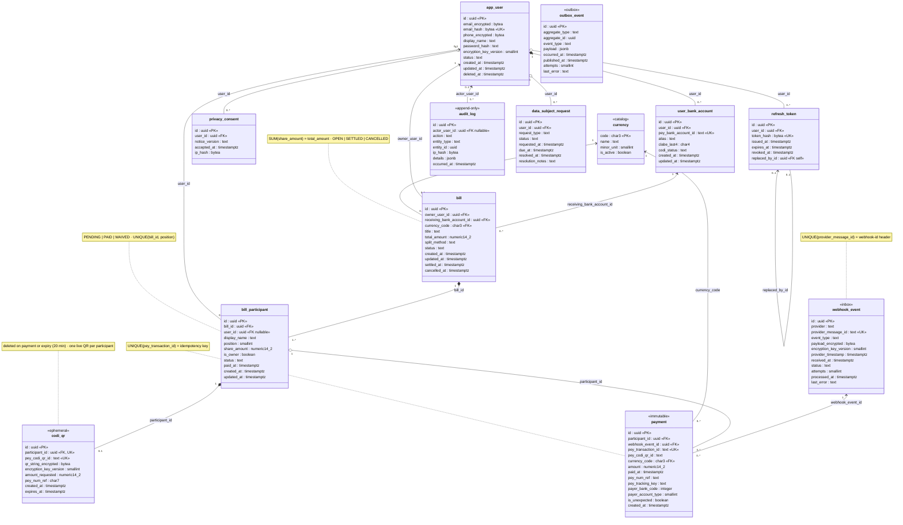

# Diagrama UML de la base de datos

Diagrama de clases UML del esquema propuesto en [01-data-model.md](01-data-model.md). Cada clase es una tabla; los atributos llevan tipo PostgreSQL y marca `«PK»`, `«FK»`, `«UK»` (único). Las multiplicidades están en los extremos de cada asociación. Versión renderizada: [database-uml.svg](database-uml.svg).

> Nota Mermaid: `char3`, `char4`, `char7` y `numeric14_2` representan `char(3)`, `char(4)`, `char(7)` y `numeric(14,2)`; Mermaid interpreta los paréntesis como métodos.

Convenciones UML usadas:
- **Composición** (rombo relleno): el hijo no existe sin el padre y se borra con él (`bill_participant`, `codi_qr`).
- **Agregación** (rombo vacío): el hijo referencia al padre pero sobrevive a su anonimización (`payment`, `refresh_token`, `privacy_consent`).
- **Asociación** simple: referencia por FK sin ciclo de vida compartido.
- Las clases con `«ephemeral»` se borran físicamente; `«immutable»` nunca se actualizan; `«inbox»`/`«outbox»` son tablas de mensajería; `«catalog»` es dato de referencia.

## Lectura rápida de las relaciones

| Relación | Multiplicidad | Tipo | Significado |
|---|---|---|---|
| `app_user` → `bill` | 1 : 0..* | asociación | Un usuario es dueño de muchas cuentas; toda cuenta tiene exactamente un dueño. |
| `bill` ◆ `bill_participant` | 1 : 1..* | composición | Una cuenta se divide en al menos un participante; los participantes se borran con la cuenta. |
| `app_user` → `bill_participant` | 0..1 : 0..* | asociación | Un participante puede ser usuario registrado o invitado (sin usuario). |
| `bill_participant` ◆ `codi_qr` | 1 : 0..1 | composición | A lo más un QR vivo por cobro. |
| `bill_participant` ◇ `payment` | 1 : 0..* | agregación | Normalmente 0 o 1 pago; más de uno solo si `is_unexpected`. |
| `webhook_event` → `payment` | 1 : 0..* | asociación | Cada pago nace de un evento del inbox; un evento puede no producir pago (duplicado). |
| `user_bank_account` → `bill` | 1 : 0..* | asociación | La cuenta receptora del dinero se fija al crear la cuenta. |
| `currency` → `bill`, `payment` | 1 : 0..* | asociación | Divisa de la cuenta y divisa reportada por Pey (hoy siempre MXN). |
| `refresh_token` → `refresh_token` | 0..1 : 0..1 | auto-asociación | Cadena de rotación para detectar reuso. |

`outbox_event` no tiene FK a propósito: referencia agregados por `(aggregate_type, aggregate_id)` para que el relay no dependa del esquema de negocio y los eventos sobrevivan a borrados físicos (`codi_qr`).

## Alternativa que el equipo está evaluando

Si deciden separar el cobro del participante, el cambio es local: aparece `charge { id, participant_id «FK», amount, status, created_at }` entre `bill_participant` y `codi_qr`/`payment` (`bill_participant 1 — 0..* charge`, `charge 1 — 0..1 codi_qr`, `charge 1 — 0..* payment`), y `share_amount`/`status`/`paid_at` salen de `bill_participant`. El resto del diagrama no se mueve.
