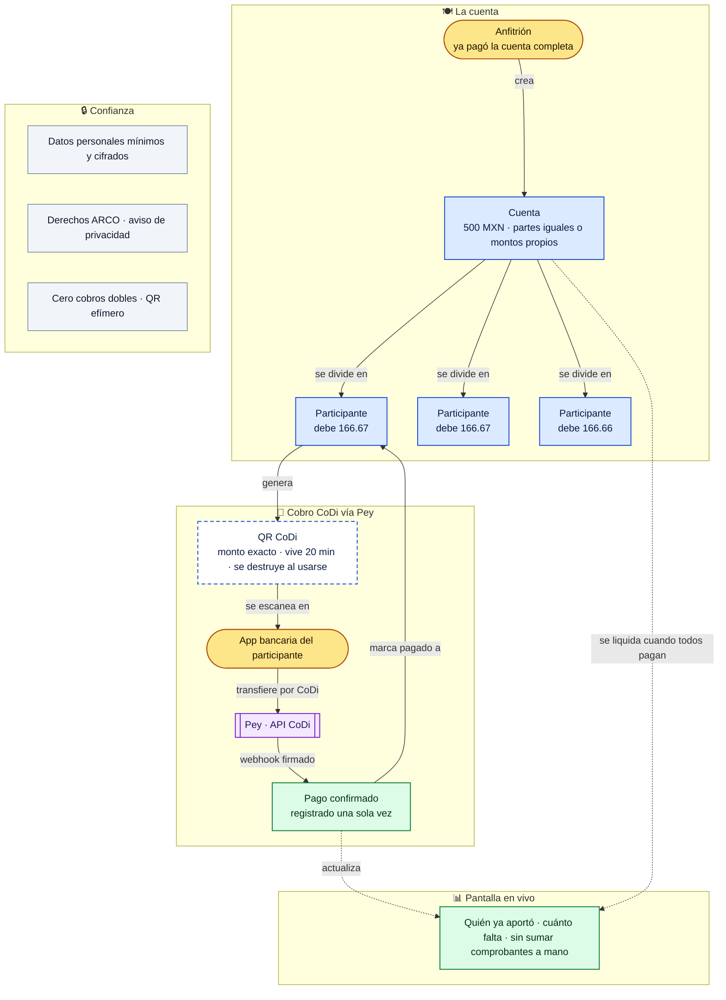

# Diagrama conceptual para el pitch

Versión abstracta del modelo (sin tablas, tipos ni columnas) pensada para explicar la idea ante los jueces en menos de un minuto. Renderizado: [pitch-diagram.png](pitch-diagram.png) · [pitch-diagram.svg](pitch-diagram.svg).
La versión técnica completa está en [04-database-uml.md](04-database-uml.md).

## Cómo narrarlo (30 segundos)

1. **La cuenta**: alguien ya pagó; en la app crea la cuenta y la divide. El sistema cuadra los centavos solo.
2. **El cobro**: cada participante recibe su propio QR CoDi con su monto exacto. Lo escanea con la app de su banco, sin tarjeta, sin efectivo, sin comisión.
3. **Pey**: Pey genera el QR ante Banxico y nos avisa con un webhook firmado cuando el dinero llegó. Verificamos con Pey y marcamos pagado. El QR desaparece: no puede cobrarse dos veces.
4. **La pantalla**: todos ven en vivo quién aportó y cuánto falta. Cuando el último paga, la cuenta se liquida sola.
